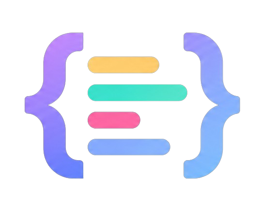

<p align="center"></p>

# Synhigh code highlighter

A small, dependency-free syntax highlighter for the web. Plain JavaScript and CSS, written from scratch, with no third-party code.

- **Automatic language detection:** reads `language-php`-style classes, and falls back to analysing the code itself.
- **18 languages with aliases:** HTML/XML/SVG, CSS/SCSS/LESS, JavaScript/TypeScript/JSX, JSON, PHP, SQL, Python, Bash/Shell, C, C++, Java/Kotlin, C#, Go, Rust, YAML/TOML/INI, Ruby, Diff, Markdown.
- **Mixed-language snippets:** `<style>`, `<script>` and `<?php ?>` inside HTML are each highlighted as their own language.
- **Line numbers:** generated by CSS, so they are never selected or copied.
- **Copy button:** copies the original source, with exact spacing and tabs.
- **Themes:** four built in (`auto`, `dark`, `light`, `ember`), all driven by CSS variables.
- **Safe by design:** all code is HTML-escaped before it is inserted.

> Using WordPress? The same engine ships as a plugin with a settings page. See the plugin's own README.

## Quick start

1. Copy `synhigh.css` and `synhigh.js` to your site.
2. Add them to your page:

```html
<link rel="stylesheet" href="dists/css/synhigh.css">
<script src="dists/js/synhigh.js" defer></script>
```

3. Write code blocks as usual:

```html
<pre>
    <code class="language-php">
        <?php echo "Hello"; ?>
    </code>
</pre>
```

Open `index.html` in this folder for a working demo.

## Choosing the language

| You write | Result |
|---|---|
| `class="language-php"`, `lang-php` or `php` on `<code>` or `<pre>` | That language |
| `data-lang="php"`, `data-language="php"` or `data-synhigh-lang="php"` | That language |
| No hint | Detected automatically |
| `class="nohighlight"` (also `no-highlight`, `synhigh-off`, `language-text`, `language-plaintext`) | Left untouched |

Automatic detection is a heuristic. It is dependable for anything beyond a few lines, but a very short snippet can be misjudged, so set the class whenever you know the language.

Per-block options:

```html
<pre data-line-numbers="false">
    <code>...</code>
</pre>   
<!-- hide line numbers -->

<pre data-start="42">
    <code>...</code>
</pre>
<!-- start numbering at 42 -->
```

## Configuration

Set options before the script loads:

```html
<script>
  window.SynhighConfig = {
    theme: 'auto',          // auto | dark | light | ember | any registered theme
    lineNumbers: true,
    minLinesForNumbers: 2,  // hide numbers for one-line snippets
    copyButton: true,
    showLabel: true,        // language name in the header bar
    autoDetect: true,
    observe: false,         // watch the DOM for blocks added later
    selector: 'pre code, pre.wp-block-code, pre.wp-block-preformatted.synhigh',
    i18n: { copy: 'Copy', copied: 'Copied!', failed: 'Failed', copyAria: 'Copy code to clipboard' }
  };
</script>
<script src="dists/js/synhigh.js" defer></script>
```

`i18n` lets you translate the button labels. Only the keys you set are replaced.

## Themes

Every colour is a CSS variable. Override them for the whole site:

```css
.synhigh {
  --synhigh-bg: #0b1d2a;
  --synhigh-fg: #d6e4f0;
  --synhigh-keyword: #ff9e64;
  --synhigh-string: #9ece6a;
}
```

| Variables (each prefixed `--synhigh-`) | Used for |
|---|---|
| `bg`, `fg`, `muted`, `border`, `lineno`, `selection` | Container, text, header bar, line numbers |
| `comment`, `keyword`, `string`, `number`, `fn`, `var`, `type`, `const` | Core tokens |
| `op`, `punct`, `tag`, `attr`, `builtin`, `meta`, `regex` | Operators, punctuation, markup, built-ins |
| `inserted`, `deleted` | Diff lines |

Register a named theme, either in the config or from script:

```js
window.SynhighConfig = {
  theme: 'ocean',
  themes: { ocean: { bg: '#0b1d2a', fg: '#d6e4f0', keyword: '#ff9e64', string: '#9ece6a' } }
};

// or, after the script has loaded:
Synhigh.registerTheme('ocean', { bg: '#0b1d2a', fg: '#d6e4f0' });
```

Theme names may contain letters, numbers, `-` and `_`. Colour values are checked before they are written into a stylesheet.

## JavaScript API

| Function | Description |
|---|---|
| `Synhigh.highlightAll(scope?)` | Highlight every matching block, optionally only inside `scope`. Call it after inserting content dynamically. |
| `Synhigh.highlightElement(node)` | Highlight a single `<pre>` or `<code>`. |
| `Synhigh.highlight(code, lang?, { auto })` | Returns `{ lang, html, lines }` without touching the DOM. Pass `{ auto: false }` to skip detection. |
| `Synhigh.detect(code)` | Returns a language name, or `null` when nothing is confident enough. |
| `Synhigh.analyze(code)` | Returns `{ scores, best, confidence }` so you can see how sure the guess is. |
| `Synhigh.languages()` | Lists the available language names. |
| `Synhigh.resolve(name)` | Maps an alias (`js`, `py`, `c++`, `sh`) to a language name, or `null`. |
| `Synhigh.registerTheme(name, colors)` | Adds a theme. |
| `Synhigh.define(name, definition)` | Adds a language (see below). |

```js
const out = Synhigh.highlight('SELECT * FROM posts;', 'sql');
element.innerHTML = out.html;   // a block of <span class="synhigh-line"> elements
```

## Adding a language

A language is a list of rules. Each rule has a regular expression `r` and a token type `t`. Rules are tried in order at each position, and the first match wins.

```js
Synhigh.define('toml2', {
  aliases: ['t2'],
  rules: [
    { r: /#.*/,               t: 'comment' },
    { r: /"(?:\\.|[^"\\\n])*"/, t: 'string' },
    { r: /\b(?:true|false)\b/, t: 'const' },
    { r: /\b\d+(?:\.\d+)?\b/,  t: 'number' },
    { r: /^\s*\[[^\]\n]+\]/m,  t: 'keyword' }
  ]
});
```

Rules and conventions:

- **No capture groups.** Use `(?:...)`. Rules with a capture group are skipped (turn on `Synhigh.debug = true` to see a console warning).
- **Token types:** `comment keyword string number fn var type const op punct tag attr builtin meta regex inserted deleted`.
- **Case-insensitive languages:** add `ci: true` (SQL does this).
- **Embedded languages:** `{ r: /<script\b[^>]*>/, end: /<\/script\s*>/, lang: 'javascript' }` highlights everything between the two matches as another language.
- **Nested tokenizing:** `{ r: /<tag ...>/, sub: 'other-language' }` re-tokenizes just the matched text.
- **Helpers:** `Synhigh.util` has `W('word list')` (whole-word matcher), `dq`/`sq` (string patterns), `num`, `fn`, `lc`/`bc` (line and block comments), and `esc`.

To make a new language detectable, add signature patterns to `SIG` in `src/synhigh-detect.js`.

## How it works

1. **Find a language.** A class or data attribute wins. Otherwise `Synhigh.analyze` scores each language by weighted signature patterns and picks the best one above a confidence threshold.
2. **Tokenize.** Each language compiles into a single combined regular expression, so the code is scanned once from left to right.
3. **Render.** Tokens are grouped into one `<span class="synhigh-line">` per source line, which is what makes CSS line numbers and exact whitespace possible.

## Limitations

- **Regex grammars, not parsers.** Highlighting is accurate for typical code but can be wrong on unusual constructs (for example a regular-expression literal right after a closing bracket in JavaScript).
- **Large blocks:** blocks over 150,000 characters are shown unhighlighted, to keep pages responsive.
- **Short snippets:** auto-detection can misjudge a few lines. Set the class explicitly.
- **Not a code editor:** this renders read-only code. It does not edit, fold or search.

## Browser support

Current versions of Chrome, Edge, Firefox and Safari. The scripts use ES5 syntax and avoid regex lookbehind. The copy button uses the Clipboard API, with a fallback for non-HTTPS pages. Line numbers need CSS counters and `position: sticky`.

## Compatibility with your site's CSS

Every selector is scoped under `.synhigh`, and the code area resets the properties that site themes most often force onto `pre`, `code` and `button` (including `!important` backgrounds, uppercase text and letter-spacing). Code always renders left-to-right, even on right-to-left pages.

